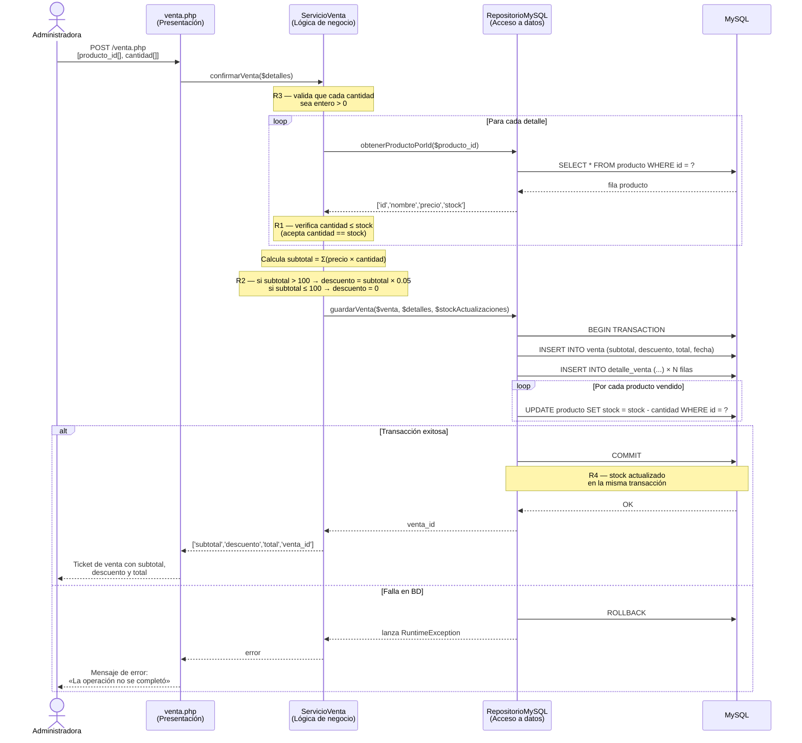

# Design Document — Bodega «Doña Rosa»

## Overview

La aplicación web **Bodega «Doña Rosa»** reemplaza el cuaderno manual de ventas por un sistema local que corre sobre XAMPP (PHP 8 + MySQL). Permite registrar productos, consultar el inventario y registrar ventas calculando automáticamente subtotales, descuentos y totales, mientras actualiza el stock de forma transaccional.

El diseño prioriza tres objetivos:

1. **Testeabilidad**: la lógica de negocio debe poder probarse con PHPUnit sin base de datos real.
2. **Simplicidad**: sin framework, sin librerías externas salvo PHPUnit.
3. **Corrección**: las reglas de negocio (R1–R4) se aplican siempre en la capa correcta.

---

## Architecture

La aplicación sigue una **arquitectura en tres capas** adaptada a PHP sin framework:

```
┌──────────────────────────────────────────┐
│          Capa de Presentación            │
│  (archivos .php con HTML — sin lógica    │
│   de negocio ni SQL directo)             │
└──────────────────┬───────────────────────┘
                   │ llama a
┌──────────────────▼───────────────────────┐
│        Capa de Lógica de Negocio         │
│  ServicioVenta  /  ServicioProducto      │
│  (src/ — sin HTML ni SQL directo)        │
│  Recibe RepositorioVentaInterface        │
│  por constructor (DI)                    │
└──────────────────┬───────────────────────┘
                   │ implementa / usa
┌──────────────────▼───────────────────────┐
│         Capa de Acceso a Datos           │
│  RepositorioMySQL (implements            │
│  RepositorioVentaInterface)              │
│  PDO + sentencias preparadas             │
└──────────────────────────────────────────┘
```

### Principio clave — Inyección de dependencias

`ServicioVenta` recibe un `RepositorioVentaInterface` por constructor. Esto permite que en los tests de PHPUnit se inyecte un mock o stub sin base de datos, mientras que en producción se inyecta `RepositorioMySQL`.

```php
// Producción
$pdo        = new PDO('mysql:host=localhost;dbname=bodega', 'root', '');
$repositorio = new RepositorioMySQL($pdo);
$servicio    = new ServicioVenta($repositorio);

// Test (PHPUnit)
$mock     = $this->createMock(RepositorioVentaInterface::class);
$servicio = new ServicioVenta($mock);
```

---

## Components and Interfaces

### Interfaz `RepositorioVentaInterface`

```php
interface RepositorioVentaInterface
{
    /** Devuelve todos los productos */
    public function obtenerProductos(): array;

    /** Devuelve un producto por id o null si no existe */
    public function obtenerProductoPorId(int $id): ?array;

    /** Persiste un nuevo producto; devuelve su id */
    public function guardarProducto(string $nombre, float $precio, int $stock): int;

    /**
     * Persiste la venta y sus detalles, y actualiza el stock,
     * todo en una sola transacción. Lanza \RuntimeException si falla.
     *
     * @param array{subtotal: float, descuento: float, total: float} $venta
     * @param list<array{producto_id: int, cantidad: int, precio_unitario: float}> $detalles
     * @param array<int, int> $stockActualizaciones [producto_id => nuevo_stock]
     */
    public function guardarVenta(array $venta, array $detalles, array $stockActualizaciones): int;
}
```

### Clase `ServicioVenta` (lógica de negocio)

Responsabilidades:

- Validar R1 (stock), R2 (descuento), R3 (cantidad).
- Calcular subtotal, descuento y total.
- Preparar los datos y delegar la persistencia al repositorio.

Métodos principales:

```php
class ServicioVenta
{
    public function __construct(private RepositorioVentaInterface $repositorio) {}

    /** Valida campos de un nuevo producto y los persiste */
    public function registrarProducto(string $nombre, float $precio, int|string $stock): array;

    /** Devuelve la lista de productos desde el repositorio */
    public function listarProductos(): array;

    /**
     * Valida cada detalle, calcula totales y persiste la venta.
     *
     * @param list<array{producto_id: int, cantidad: int}> $detalles
     * @return array{subtotal: float, descuento: float, total: float, venta_id: int}
     * @throws \InvalidArgumentException si algún detalle falla R1 o R3
     */
    public function confirmarVenta(array $detalles): array;

    /** Calcula subtotal a partir de lista de detalles con precio_unitario y cantidad */
    public function calcularSubtotal(array $detalles): float;

    /** Aplica R2: devuelve descuento = subtotal * 0.05 si subtotal > 100, sino 0 */
    public function calcularDescuento(float $subtotal): float;
}
```

### Clase `RepositorioMySQL`

Implementa `RepositorioVentaInterface` usando PDO con sentencias preparadas. El método `guardarVenta()` envuelve las operaciones INSERT y UPDATE en una transacción PDO (`beginTransaction` / `commit` / `rollBack`).

### Archivos de presentación (vistas)

| Archivo              | Descripción                                      |
|----------------------|--------------------------------------------------|
| `index.php`          | Página principal / menú de navegación            |
| `productos.php`      | Lista el inventario (GET) y procesa nuevo producto (POST) |
| `venta.php`          | Formulario de nueva venta (GET) y confirma (POST) |

Las vistas reciben los datos del servicio como arrays PHP y no contienen lógica de negocio ni SQL.

---

## Data Models

### Diagrama entidad–relación

```
producto (1) ────< detalle_venta >──── (1) venta
```

### DDL SQL

```sql
CREATE TABLE producto (
    id      INT UNSIGNED    NOT NULL AUTO_INCREMENT,
    nombre  VARCHAR(150)    NOT NULL,
    precio  DECIMAL(10,2)   NOT NULL,           -- mayor que 0.00
    stock   INT UNSIGNED    NOT NULL,
    PRIMARY KEY (id)
) ENGINE=InnoDB DEFAULT CHARSET=utf8mb4;

CREATE TABLE venta (
    id        INT UNSIGNED    NOT NULL AUTO_INCREMENT,
    subtotal  DECIMAL(10,2)   NOT NULL,
    descuento DECIMAL(10,2)   NOT NULL DEFAULT 0.00,
    total     DECIMAL(10,2)   NOT NULL,
    fecha     DATETIME        NOT NULL DEFAULT CURRENT_TIMESTAMP,
    PRIMARY KEY (id)
) ENGINE=InnoDB DEFAULT CHARSET=utf8mb4;

CREATE TABLE detalle_venta (
    id              INT UNSIGNED    NOT NULL AUTO_INCREMENT,
    venta_id        INT UNSIGNED    NOT NULL,
    producto_id     INT UNSIGNED    NOT NULL,
    cantidad        INT UNSIGNED    NOT NULL,   -- mayor que 0
    precio_unitario DECIMAL(10,2)   NOT NULL,
    PRIMARY KEY (id),
    CONSTRAINT fk_detalle_venta    FOREIGN KEY (venta_id)    REFERENCES venta(id)    ON DELETE CASCADE,
    CONSTRAINT fk_detalle_producto FOREIGN KEY (producto_id) REFERENCES producto(id) ON DELETE RESTRICT
) ENGINE=InnoDB DEFAULT CHARSET=utf8mb4;
```

**Decisión de diseño**: `precio_unitario` se guarda en `detalle_venta` (no se lee de `producto`) para que un cambio futuro de precio no altere el historial de ventas.

---

## Sequence Diagram — Registrar Venta

El siguiente diagrama muestra el flujo completo e indica en qué capa se valida cada regla de negocio.



---

## Correctness Properties

*Una propiedad es una característica o comportamiento que debe cumplirse en todas las ejecuciones válidas del sistema: una afirmación formal sobre lo que el sistema debe hacer. Las propiedades sirven de puente entre las especificaciones legibles por humanos y las garantías de corrección verificables automáticamente.*

---

### Property 1: Precio de producto válido

*Para todo* valor numérico `p`, el método de validación de precio de `ServicioVenta` SHALL aceptar el valor si y solo si `p > 0.00`; para cualquier valor `p ≤ 0` SHALL rechazarlo con un mensaje de error.

**Validates: Requirements 1.3**

---

### Property 2: Stock inicial válido

*Para todo* valor `s`, el método de validación de stock de `ServicioVenta` SHALL aceptar el valor si y solo si `s` es un entero mayor que cero; para cualquier valor que sea cero, negativo o no entero (decimal, string) SHALL rechazarlo con un mensaje de error.

**Validates: Requirements 1.4**

---

### Property 3: Listado de productos es completo y fiel

*Para toda* colección arbitraria de productos almacenados en el repositorio, `ServicioVenta::listarProductos()` SHALL devolver exactamente esa colección (misma cardinalidad, mismos atributos), sin añadir ni omitir ningún elemento.

**Validates: Requirements 2.1**

---

### Property 4: Cantidad inválida siempre se rechaza (R3)

*Para todo* valor de cantidad `c` que no sea un entero estrictamente positivo (incluyendo 0, negativos y decimales), `ServicioVenta::confirmarVenta()` SHALL rechazar el detalle y lanzar una excepción con un mensaje indicando que la cantidad debe ser un entero positivo.

**Validates: Requirements 3.2**

---

### Property 5: Exceso de stock siempre se rechaza (R1)

*Para todo* par `(stock disponible S, cantidad solicitada C)` tal que `C > S`, `ServicioVenta::confirmarVenta()` SHALL rechazar la venta y lanzar una excepción que indique el stock disponible del producto. Para `C == S`, la venta SHALL ser aceptada y el stock resultante SHALL ser 0.

**Validates: Requirements 3.3, 3.4**

---

### Property 6: Cálculo de subtotal es exacto

*Para toda* lista arbitraria de detalles de venta `[(precio_i, cantidad_i)]`, `ServicioVenta::calcularSubtotal()` SHALL devolver exactamente `Σ (precio_i × cantidad_i)`, con precisión de dos decimales.

**Validates: Requirements 4.1**

---

### Property 7: Regla de descuento R2 es exhaustiva y correcta

*Para todo* subtotal `s`:
- Si `s > 100.00`: `calcularDescuento(s)` SHALL devolver `s × 0.05` y el total SHALL ser `s × 0.95`.
- Si `s ≤ 100.00` (incluido `s == 100.00`): `calcularDescuento(s)` SHALL devolver `0.00` y el total SHALL ser `s`.

**Validates: Requirements 4.2, 4.3, 4.4**

---

### Property 8: El stock se reduce correctamente al confirmar la venta (R4)

*Para toda* venta válida con `N` detalles `[(producto_id_i, cantidad_i, stock_inicial_i)]`, tras ejecutar `confirmarVenta()`, el repositorio SHALL recibir actualizaciones de stock tales que `stock_resultante_i == stock_inicial_i − cantidad_i` para cada producto `i`. Si el repositorio lanza una excepción, ninguna actualización de stock ni inserción de venta SHALL persistirse.

**Validates: Requirements 5.1, 5.2, 5.3**

---

## Error Handling

| Situación | Capa que detecta | Respuesta al usuario |
|-----------|-----------------|----------------------|
| Campo obligatorio vacío (nombre, precio, stock) | ServicioVenta | Mensaje indicando el campo faltante |
| Precio ≤ 0 | ServicioVenta | «El precio debe ser mayor que S/ 0,00» |
| Stock inicial no es entero > 0 | ServicioVenta | «El stock debe ser un número entero positivo» |
| Cantidad inválida en detalle de venta (R3) | ServicioVenta | «La cantidad debe ser un entero mayor que cero» |
| Cantidad supera stock disponible (R1) | ServicioVenta | «Stock disponible para [producto]: [N] unidades» |
| Fallo en transacción de BD (R4) | RepositorioMySQL (captura excepción PDO, hace ROLLBACK, relanza RuntimeException) | «La operación no se completó. Intente de nuevo.» |
| Producto no encontrado por id | RepositorioMySQL | Devuelve `null`; ServicioVenta lanza InvalidArgumentException |

Las excepciones del dominio son `\InvalidArgumentException` (datos incorrectos del usuario) y `\RuntimeException` (fallo de infraestructura). La vista los captura con `try/catch` y muestra el mensaje correspondiente.

---

## Testing Strategy

### Herramienta

PHPUnit (único PHPUnit.phar ya presente en el repositorio). Sin librerías externas adicionales para la ejecución básica.

### Nivel de tests

#### Tests unitarios — `ServicioVenta` (sin base de datos)

Se usa `createMock(RepositorioVentaInterface::class)` para aislar completamente la lógica de negocio.

Cubren:
- Campos obligatorios de producto (ejemplos/edge cases).
- Rechazo de precio ≤ 0 (edge cases: 0, -1, -0.01).
- Aceptación de precio > 0 (edge cases: 0.01, 1, 999.99).
- Rechazo de stock inválido (0, -5, 1.5, «abc»).
- Listado vacío y listado con productos.
- Rechazo de cantidad inválida (0, -3, 2.7).
- Rechazo de cantidad > stock; aceptación de cantidad == stock.
- Cálculo de subtotal con uno y múltiples detalles.
- Cálculo de descuento: subtotal exactamente 100.00 (sin descuento), 100.01 (con descuento), 50.00 (sin descuento), 200.00 (con descuento).
- Fallo del repositorio: mock lanza RuntimeException → verificar que el servicio la propaga.

#### Tests de propiedad — `ServicioVenta`

Implementados con PHPUnit mediante bucles de iteraciones (mínimo 100 por propiedad), ya que el proyecto no incluye una librería PBT dedicada. Cada propiedad se etiqueta con un comentario `@Feature: bodega-dona-rosa, Property N`.

| Propiedad | Descripción resumida | Iteraciones |
|-----------|----------------------|-------------|
| Property 1 | Precio válido / inválido | ≥ 100 |
| Property 2 | Stock inicial válido / inválido | ≥ 100 |
| Property 3 | Listado completo y fiel | ≥ 100 |
| Property 4 | Cantidad inválida siempre rechazada (R3) | ≥ 100 |
| Property 5 | Exceso de stock siempre rechazado (R1) | ≥ 100 |
| Property 6 | Subtotal exacto | ≥ 100 |
| Property 7 | Regla de descuento R2 exhaustiva | ≥ 100 |
| Property 8 | Stock reducido correctamente (R4) | ≥ 100 |

#### Tests de integración — `RepositorioMySQL`

Requieren una base de datos de test (`bodega_test`). Cubren:

- Insertar producto y recuperarlo por id.
- `guardarVenta()`: verificar atomicidad (commit cuando todo va bien, rollback cuando falla un UPDATE).
- Stock actualizado tras venta exitosa.

> Estos tests se ejecutan solo en entornos con MySQL disponible y se pueden omitir con `--exclude-group integration` en la ejecución de PHPUnit normal.

### Estructura de carpetas sugerida

```
bodega/
├── src/
│   ├── RepositorioVentaInterface.php
│   ├── RepositorioMySQL.php
│   └── ServicioVenta.php
├── tests/
│   ├── ServicioVentaTest.php          ← unitarios + propiedades
│   └── RepositorioMySQLTest.php       ← integración
├── index.php
├── productos.php
├── venta.php
├── phpunit.xml
└── phpunit.phar
```
